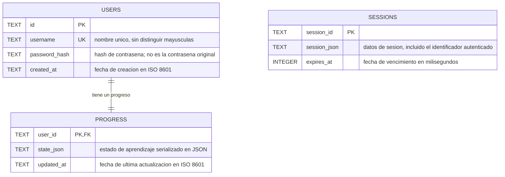

# Modelo entidad-relación de CODIGEASS

## Motor de base de datos

CODIGEASS utiliza **SQLite**. Es una base de datos relacional guardada en un archivo local, no una base en la nube. En Windows, el servidor crea por defecto este archivo fuera del repositorio:

```text
C:\Users\<tu-usuario>\.codigeass\codigeass.sqlite
```

El servidor crea las tablas al iniciar y utiliza claves foráneas de SQLite para proteger la relación entre usuario y progreso.

## Diagrama entidad-relación



`UK` indica un valor único. La relación `USERS ||--|| PROGRESS` es uno a uno: un usuario tiene como máximo un registro de progreso y cada registro de progreso pertenece exactamente a un usuario. El campo `progress.user_id` es, al mismo tiempo, su clave primaria y una clave foránea que apunta a `users.id`. Si se elimina un usuario, la clave foránea elimina también su progreso.

`SESSIONS` es una tabla adicional para mantener el inicio de sesión entre peticiones. La aplicación coloca el identificador del usuario autenticado dentro de `session_json`, pero SQLite **no tiene una clave foránea desde `sessions` a `users`**. Por eso las sesiones no aparecen conectadas mediante una relación en el diagrama.

## Qué contiene `state_json`

La tabla `progress` tiene un registro por usuario. El campo `state_json` es texto con JSON que agrupa el progreso de la cuenta:

| Campo dentro del JSON | Significado |
| --- | --- |
| `xp` | Puntos de experiencia |
| `hearts` | Vidas actuales, de 0 a 5 |
| `streak` | Racha de días con actividad |
| `lastActivityDate` | Fecha de la actividad más reciente |
| `joinedAt` | Fecha de registro |
| `heartUpdatedAt` | Momento usado para calcular la recuperación de vidas |
| `completedLessons` | Identificadores de lecciones en formato `curso:leccion`, por ejemplo `html:estructura` |
| `completedChallenges` | Identificadores de los desafíos completados |
| `dailyDate` | Fecha a la que corresponde la misión diaria |
| `dailyActivities` | Actividades completadas durante ese día |
| `dailyRewardClaimed` | Indica si se entregó la recompensa diaria |
| `inventory.doubleXpUntil` | Momento en que vence el multiplicador de XP |
| `inventory.ninja` | Indica si el usuario compró el avatar Ninja |
| `inventory.cyberTitle` | Indica si el usuario compró el título Cyber Dev |

El JSON mantiene todos los datos de progreso en una sola fila. Por eso, elementos como las lecciones completadas, los artículos y las ligas **no son tablas independientes** en la versión actual.

El avance de cada curso se diferencia mediante el prefijo del identificador de la lección. Por ejemplo, `python:clases` y `java:clases` son ejercicios diferentes. Las cuentas que tenían progreso en la versión anterior conservan sus lecciones de Python: el servidor transforma esos identificadores al formato nuevo la primera vez que lee el progreso.

## Tablas físicas

### `users`

| Columna | Tipo | Restricciones | Para qué sirve |
| --- | --- | --- | --- |
| `id` | `TEXT` | Clave primaria (`PK`) | Identificador interno único del usuario, generado por el servidor |
| `username` | `TEXT` | Obligatorio y único (`UK`), comparación sin distinguir mayúsculas | Nombre de acceso |
| `password_hash` | `TEXT` | Obligatorio | Hash de la contraseña generado con bcrypt |
| `created_at` | `TEXT` | Obligatorio | Fecha de creación de la cuenta en formato ISO 8601 |

### `progress`

| Columna | Tipo | Restricciones | Para qué sirve |
| --- | --- | --- | --- |
| `user_id` | `TEXT` | Clave primaria y clave foránea (`PK`, `FK`) a `users.id` | Identifica al usuario propietario del progreso |
| `state_json` | `TEXT` | Obligatorio | JSON con XP, vidas, racha, misiones y progreso de aprendizaje |
| `updated_at` | `TEXT` | Obligatorio | Fecha de la última actualización en formato ISO 8601 |

### `sessions`

| Columna | Tipo | Restricciones | Para qué sirve |
| --- | --- | --- | --- |
| `session_id` | `TEXT` | Clave primaria (`PK`) | Identificador de la sesión del navegador |
| `session_json` | `TEXT` | Obligatorio | Datos de la sesión de acceso |
| `expires_at` | `INTEGER` | Obligatorio | Momento de expiración en milisegundos |

También existe el índice `sessions_expiry_idx` sobre `sessions.expires_at` para facilitar la limpieza de sesiones vencidas.

## Ejemplo de relación

La cuenta de un estudiante y su progreso se pueden representar con estos datos ficticios:

```text
users
┌──────────────────────────────────┬──────────┬────────────────┬──────────────────────────┐
│ id                               │ username │ password_hash  │ created_at               │
├──────────────────────────────────┼──────────┼────────────────┼──────────────────────────┤
│ 9ab1...                          │ ana123   │ $2b$12$...     │ 2026-10-24T18:00:00.000Z │
└──────────────────────────────────┴──────────┴────────────────┴──────────────────────────┘
                 │
                 │ users.id = progress.user_id
                 │ relación 1 : 1
                 ▼
progress
┌──────────────────────────────────┬──────────────────────────────┬──────────────────────────┐
│ user_id                          │ state_json                   │ updated_at               │
├──────────────────────────────────┼──────────────────────────────┼──────────────────────────┤
│ 9ab1...                          │ {"xp":50,"hearts":5,...}     │ 2026-10-24T18:05:00.000Z │
└──────────────────────────────────┴──────────────────────────────┴──────────────────────────┘
```

Los valores son ilustrativos: no muestran información de una cuenta real.

## Cómo mostrarlo en clase

- La sección **Diagrama entidad-relación** puede mostrarse en GitHub o en un editor de Markdown compatible con Mermaid.
- Las tablas y la explicación de las claves se pueden copiar directamente a la presentación.
- Para ver la base real, el archivo `codigeass.sqlite` se puede abrir con un visor de SQLite, como la extensión **SQLite** de VS Code. No subas ese archivo a un repositorio público: contiene cuentas y el historial de acceso local.

## Correspondencia con el código

El servidor crea las tablas `users`, `progress` y `sessions` en la función `initializeDatabase` de `server.js`. El estado que se guarda dentro de `progress.state_json` se define en `createInitialProgress`, en `src/game.js`.
